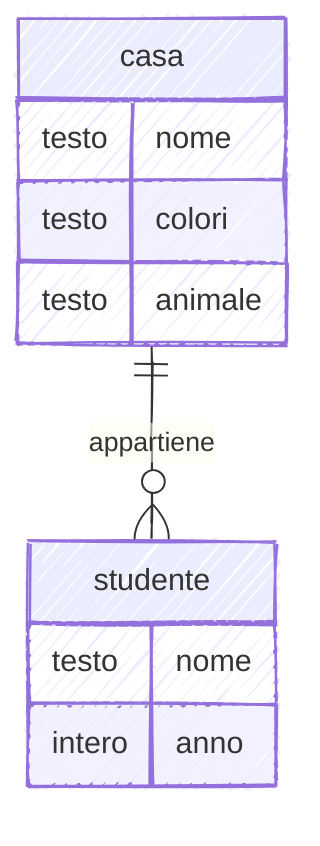
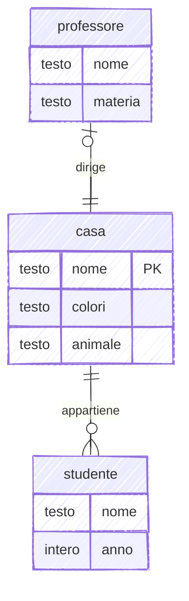

import DiagrammaER from '@site/src/components/DiagrammaER';

# Diagrammi ER — pagina di test

Prova della fase E0 di `pm/piano-2026-10-lezione-entita-attributi.md`. Lo stesso
diagramma in due versioni: **A** è Mermaid `erDiagram` con `look: handDrawn`, **B** è il
prototipo `<DiagrammaER>` (rough.js + Excalifont, notazione Batini). Nessun
identificatore marcato nel caso 1, come nella lezione.

## Caso 1 — casa e studente

### A · Mermaid handDrawn

### B · DiagrammaER (prototipo)

<DiagrammaER
  titolo="Le entità casa e studente, collegate dall'associazione appartiene"
  descrizione="casa ha gli attributi nome, colori e animale; studente ha nome e anno. Ogni studente appartiene a una e una sola casa (1,1); una casa ha da zero a molti studenti (0,N)."
  entita={[
    { id: 'casa', col: 0, riga: 0, attributi: ['nome', 'colori', 'animale'] },
    { id: 'studente', col: 2, riga: 0, attributi: ['nome', 'anno'] },
  ]}
  associazioni={[
    {
      id: 'appartiene',
      col: 1,
      riga: 0,
      tra: [
        { entita: 'casa', card: '(0,N)' },
        { entita: 'studente', card: '(1,1)' },
      ],
    },
  ]}
/>

## Caso 2 — tre entità, una associazione in verticale

Serve a vedere se la disposizione automatica regge quando il diagramma cresce:
attributi sopra e sotto, un identificatore, un'associazione verticale.

### A · Mermaid handDrawn

### B · DiagrammaER (prototipo)

<DiagrammaER
  titolo="Studente, casa e professore"
  entita={[
    { id: 'studente', col: 0, riga: 0, attributi: ['nome', 'anno'] },
    {
      id: 'casa',
      col: 2,
      riga: 0,
      attributi: [{ nome: 'nome', identificatore: true }, 'colori', 'animale'],
    },
    {
      id: 'professore',
      col: 2,
      riga: 2,
      attributi: ['nome', 'materia'],
      latoAttributi: 'sotto',
    },
  ]}
  associazioni={[
    {
      id: 'appartiene',
      col: 1,
      riga: 0,
      tra: [
        { entita: 'studente', card: '(1,1)' },
        { entita: 'casa', card: '(0,N)' },
      ],
    },
    {
      id: 'dirige',
      col: 2,
      riga: 1,
      tra: [
        { entita: 'casa', card: '(1,1)' },
        { entita: 'professore', card: '(0,1)' },
      ],
    },
  ]}
/>
