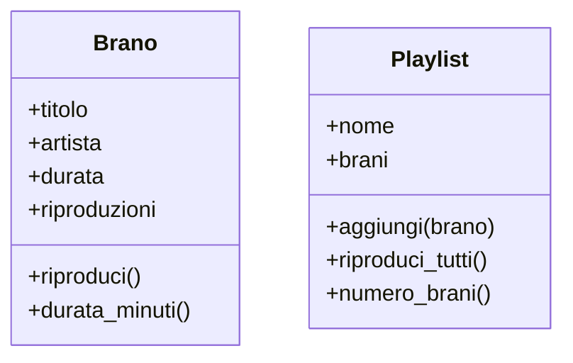

---
layout: epigrafe
autore: Massima delfica (Tempio di Apollo a Delfi)
---

Conosci te stesso.

---
layout: obiettivi
---

# Da dove partiamo, dove arriviamo

::prerequisiti::

- _Perché gli oggetti?_: un oggetto tiene insieme **dati** e **comportamento**
- Variabili, condizioni, cicli, funzioni
- Liste: `append` e ciclo `for`
- _f-string_

::imparerai::

- Che cosa fa il costruttore `__init__`
- Chi è `self`, e perché non lo passi mai tu
- **Attributi** e **metodi**, con la dot notation
- Calcolare invece di memorizzare
- Le prime notazioni **UML** e i nomi secondo PEP 8

---
layout: sezione
---

# Si riparte da Brano

La classe della lezione precedente è il punto di partenza: oggi apriamo il cofano.

---

# Tre domande, tre meccanismi

Che cosa succede quando scrivi `Brano("Bohemian Rhapsody", "Queen", 354)`?

<PyRun uscita="destra">

```python
class Brano:
    def __init__(self, titolo, artista, durata):
        self.titolo = titolo
        self.artista = artista
        self.durata = durata
        self.riproduzioni = 0

    def riproduci(self):
        self.riproduzioni += 1
        return f"▶  {self.titolo} — {self.artista}"
bohemian = Brano("Bohemian Rhapsody", "Queen", 354)
print(bohemian.riproduci())
```

</PyRun>

---
layout: sezione
---

# `__init__`: il costruttore

Un oggetto appena nato è una scatola vuota. Chi gli dice il suo titolo?

---

# Python lo chiama da solo

`__init__` (si legge _dunder init_) **inizializza lo stato** dell'oggetto appena creato. Non lo chiami mai tu: tre oggetti, tre stampe.

<PyRun uscita="destra">

```python
class Brano:
    def __init__(self, titolo, artista, durata):
        print(f"Sto costruendo: {titolo}")
        self.titolo = titolo
        self.artista = artista
        self.durata = durata

bohemian = Brano("Bohemian Rhapsody", "Queen", 354)
blinding = Brano("Blinding Lights", "The Weeknd", 200)
bury = Brano("Bury a Friend", "Billie Eilish", 193)
```

</PyRun>

---
layout: definizione
titolo: Costruttore e istanziazione
---

Il **costruttore** `__init__` porta un oggetto da «scatola vuota» a «pronto all'uso», assegnando i suoi valori iniziali.

L'atto di creare un oggetto da una classe si chiama **istanziazione**: `Brano("…", "…", 354)` istanzia un nuovo `Brano`.

---
layout: sezione
---

# self: l'oggetto che conosce sé stesso

Il primo parametro di ogni metodo, che nessuno passa a mano.

---

# Tre argomenti per quattro parametri

```python
def __init__(self, titolo, artista, durata):   # 4 parametri
    ...

bohemian = Brano("Bohemian Rhapsody", "Queen", 354)  # 3 argomenti
```

- `self` non lo passi tu: **lo passa Python**.
- È il riferimento all'oggetto **specifico** che si sta costruendo o usando.
- `self.titolo = titolo` vuol dire: attacca questo titolo **a questo brano qui**.

---

# Ogni oggetto ha il suo self

<PyRun uscita="destra">

```python
class Brano:
    def __init__(self, titolo):
        self.titolo = titolo
        self.riproduzioni = 0

    def riproduci(self):
        self.riproduzioni += 1

bohemian = Brano("Bohemian Rhapsody")
bury = Brano("Bury a Friend")
bohemian.riproduci()
bohemian.riproduci()
bohemian.riproduci()
print(bohemian.riproduzioni, bury.riproduzioni)
```

</PyRun>

---
layout: domanda
affiancata: true
invito: Che cosa stampano le due chiamate? Fanno la stessa cosa?
---

# Che cosa succede sotto il cofano

<PyRun seguito>

```python
class Brano:
    def __init__(self, titolo):
        self.riproduzioni = 0

    def riproduci(self):
        self.riproduzioni += 1
        return self.riproduzioni

bohemian = Brano("Bohemian Rhapsody")
print(bohemian.riproduci())       # come lo scrivi tu
print(Brano.riproduci(bohemian))  # come lo legge Python
```

</PyRun>

::risposta::

`1` e poi `2`: è la stessa chiamata, sullo stesso oggetto. Python prende l'oggetto **a sinistra del punto** e lo passa come `self`.

---

# Esplicito è meglio che implicito

<Callout tipo="code" titolo="this e self">

In Java, C++ e JavaScript lo stesso riferimento esiste, ma è implicito e si chiama `this`. Python lo rende esplicito, come dice lo _Zen of Python_: _explicit is better than implicit_.

</Callout>

È letteralmente l'oggetto che **conosce sé stesso**: ogni `self.qualcosa` è un dato che porta con sé e a cui può sempre accedere.

---
layout: sezione
---

# Attributi e metodi

Ciò che un oggetto ha, e ciò che sa fare.

---
layout: due-colonne
sinistra: Attributi · lo stato
destra: Metodi · il comportamento
---

# Due tipi di cose dentro una classe

::sinistra::

Le variabili attaccate a un oggetto: ciò che **ha**.

- Si creano nel costruttore con `self.x = …`
- Ogni istanza ha la sua copia
- `titolo`, `artista`, `durata`, `riproduzioni`

::destra::

Le funzioni definite nella classe: ciò che **sa fare**.

- Il primo parametro è `self`
- Vivono nella classe, agiscono sull'oggetto
- `riproduci()`

---

# La dot notation: la differenza sono le parentesi

<PyRun uscita="destra">

```python
class Brano:
    def __init__(self, titolo, durata):
        self.titolo = titolo
        self.durata = durata

    def riproduci(self):
        return f"▶  {self.titolo}"

bohemian = Brano("Bohemian Rhapsody", 354)
print(bohemian.titolo)        # attributo
print(bohemian.riproduci())   # metodo
bohemian.durata = 355         # scrivo dall'esterno
print(bohemian.durata)
```

</PyRun>

Scrivere dall'esterno scavalca ogni controllo: lo affronta l'**incapsulamento**.

---

# Un metodo che lavora lo stato

<PyRun uscita="destra">

```python
class Brano:
    def __init__(self, titolo, durata):
        self.titolo = titolo
        self.durata = durata

    def durata_minuti(self):
        minuti = self.durata // 60
        secondi = self.durata % 60
        return f"{minuti}:{secondi:02d}"

bohemian = Brano("Bohemian Rhapsody", 354)
print(bohemian.durata_minuti())
```

</PyRun>

`durata_minuti` non aggiunge dati: parte da `self.durata`, l'unico dato vero, e ne **ricava** una forma leggibile.

---

# I tre inciampi classici con self

<Callout tipo="warning" titolo="Riconoscerli fa risparmiare ore">

1. **`self` dimenticato tra i parametri**: `def riproduci():` → dentro il metodo `self` non esiste (`NameError`).
2. **`self.` dimenticato nel corpo**: `riproduzioni += 1` è una variabile locale inesistente, non l'attributo.
3. **Parentesi sbagliate**: `bohemian.titolo()` è un `TypeError`; `bohemian.riproduci` senza parentesi non esegue niente.

</Callout>

Gli attributi sono **cose che hai**, senza parentesi. I metodi sono **cose che fai**, con le parentesi.

---

# Come si chiamano le cose

<Callout tipo="cleancode" titolo="PEP 8">

- **Classi** in `PascalCase`: `Brano`, `Playlist`, `LettoreMusicale`
- **Attributi e metodi** in `snake_case`: `numero_brani`, `durata_minuti`; niente `numeroBrani`
- I metodi che rispondono sì o no si leggono come una domanda: `is_preferito()`, `ha_brani()`

</Callout>

Non è estetica: ogni sviluppatore Python dà queste convenzioni per scontate, e si confonde se le violi.

---
layout: sezione
---

# Una seconda classe: la Playlist

Risonanza raccoglie i brani in playlist: uno stato, un elenco di brani, dei comportamenti.

---

# Un oggetto che contiene altri oggetti

`brani` è una **lista di oggetti `Brano`**: si chiama **composizione**, e avrà una lezione sua.

```python
class Playlist:
    def __init__(self, nome):
        self.nome = nome
        self.brani = []          # parte vuota

    def aggiungi(self, brano):
        self.brani.append(brano)

    def riproduci_tutti(self):
        for brano in self.brani:
            print(brano.riproduci())
```

`riproduci_tutti` fa lavorare i suoi `Brano`: la collaborazione fra entità della prima lezione.

---
layout: domanda
affiancata: true
invito: Prima di eseguire, prevedi che cosa stampa l'ultima riga.
---

# L'attributo che si scollega

<PyRun seguito>

```python
class PlaylistFragile:
    def __init__(self):
        self.brani = []
        self.numero_brani = 0

    def aggiungi(self, brano):
        self.brani.append(brano)
        # dimenticato: self.numero_brani += 1

p = PlaylistFragile()
p.aggiungi("Blinding Lights")
p.aggiungi("Bury a Friend")
print(len(p.brani), p.numero_brani)
```

</PyRun>

::risposta::

`2 0`: la lista ha due brani, il contatore è fermo a zero. **Due fonti di verità** per lo stesso fatto: basta un aggiornamento dimenticato perché divergano.

---

# Non memorizzare ciò che puoi derivare

<PyRun uscita="destra">

```python
class Playlist:
    def __init__(self, nome):
        self.nome = nome
        self.brani = []

    def aggiungi(self, brano):
        self.brani.append(brano)

    def numero_brani(self):
        return len(self.brani)

p = Playlist("Workout")
p.aggiungi("Blinding Lights")
p.aggiungi("Bury a Friend")
print(p.numero_brani())
```

</PyRun>

---
layout: enunciato
---

Se un'informazione **dipende** da un'altra, tienine una sola come dato e **calcola** l'altra.

Il numero di brani dipende dalla lista, i minuti dipendono dai secondi. Due copie dello stesso fatto prima o poi si scollegano, sempre nel momento peggiore. Con `@property`, più avanti, il calcolo sembrerà un attributo.

---
layout: sezione
---

# Disegnare una classe

I programmatori non si scambiano il codice: disegnano. La notazione standard è UML.

---
layout: figura
didascalia: Nome, attributi (lo stato), metodi (il comportamento). Il + vuol dire «visibile dall'esterno».
---

# La scatola a tre scomparti

::figura::



---

# Nel codice vero: una classe per file

<Callout tipo="info" titolo="Ogni file è un'unità riusabile">

Qui `Brano` e `Playlist` stanno insieme perché devono girare in pagina. In un progetto reale si scrive **una classe per file**: `brano.py`, `playlist.py`, e un `main.py` che le importa con `from brano import Brano`.

</Callout>

Copi `brano.py` in un altro progetto e funziona, senza pescare le righe giuste da un file di ottocento.

---
layout: sintesi
---

# In sintesi

<Callout tipo="nutshell" titolo="In a nutshell">

- Il **costruttore** `__init__` inizializza lo stato; Python lo chiama **da solo**.
- `self` è l'oggetto su cui il metodo lavora: `oggetto.metodo()` è `Classe.metodo(oggetto)`.
- **Attributi**: lo stato, senza parentesi. **Metodi**: il comportamento, con le parentesi.
- Se un dato dipende da altri, **calcolalo**: due fonti di verità si scollegano.
- UML: scatola a tre scomparti. PEP 8: `PascalCase` per le classi, `snake_case` per il resto.

</Callout>

---
layout: quiz
numero: 1 di 2
---

# Passi tre argomenti a `Brano(...)`, ma `__init__` ha quattro parametri. Perché non è un errore?

<Opzione perche="`self` non ha alcun default: semplicemente non lo passi tu.">`self` ha un valore di default.</Opzione>
<Opzione corretta perche="Esatto: `Brano(...)` crea l'oggetto e lo passa come `self`. Vale per ogni metodo.">`self` lo fornisce Python: è il nuovo oggetto in costruzione.</Opzione>
<Opzione perche="Il tipo dei valori non c'entra con il numero dei parametri.">`durata` è numerico e conta come due parametri.</Opzione>
<Opzione perche="Tutti e tre gli argomenti finiscono in un attributo.">L'ultimo argomento viene ignorato.</Opzione>

---
layout: quiz
numero: 2 di 2
---

# Vuoi sapere quanti brani ci sono in una `Playlist`. Qual è l'approccio più robusto?

<Opzione perche="È la trappola dell'attributo che si scollega: due fonti di verità.">Un attributo `numero_brani` da incrementare a ogni modifica.</Opzione>
<Opzione corretta perche="Esatto: la lista è l'unica fonte di verità, il conteggio si deriva da lì.">Un metodo che restituisce `len(self.brani)`.</Opzione>
<Opzione perche="Un commento non si esegue e invecchia subito.">Contarli a mano e scriverlo in un commento.</Opzione>
<Opzione perche="Liste parallele: il bug della prima lezione, in incognito.">Una seconda lista parallela con i numeri dei brani.</Opzione>

---
layout: fine
---

# La prossima lezione

E se un'informazione riguardasse **tutti** i brani insieme, come quanti ne sono stati creati? Arrivano gli **attributi di classe** e i **metodi di classe e statici**: roba dello stampo, non del singolo biscotto.
