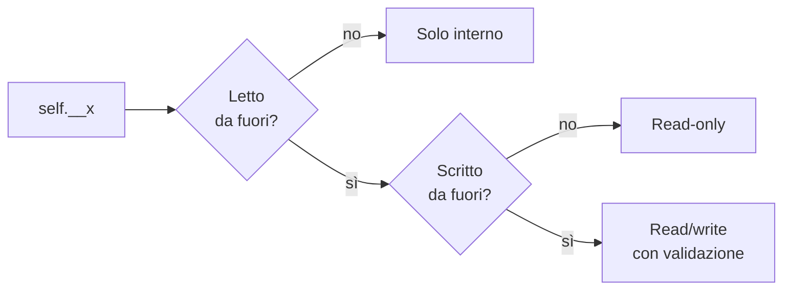
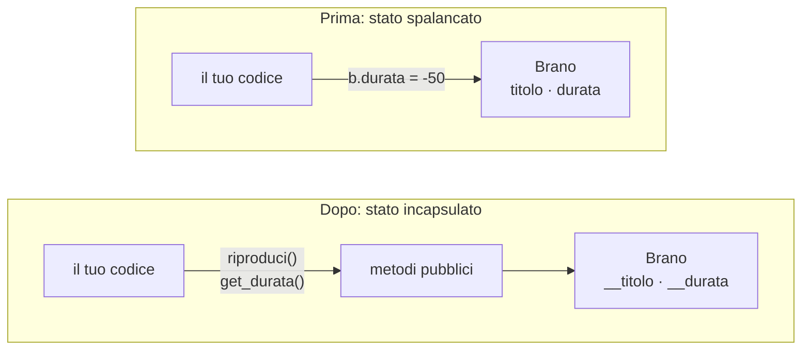

---
layout: epigrafe
autore: Gandalf — Il Signore degli Anelli, J.R.R. Tolkien
---

Keep it secret. Keep it safe.

---
layout: obiettivi
---

# Da dove partiamo, dove arriviamo

::prerequisiti::

- `self`, attributi d'istanza, `__str__` e `__repr__`
- Scrivere un `__init__` e creare istanze
- La differenza fra **leggere** `brano.durata` e **scrivere** `brano.durata = …`

::imparerai::

- Che cos'è l'**incapsulamento**
- **Interfaccia pubblica** e **stato interno**
- Le convenzioni `_` e `__` e il **name mangling**
- Quando servono **getter** e **setter**, e quando sono cerimonia
- Il principio **tell, don't ask**

---
layout: sezione
---

# Lo stato spalancato

Chiunque, da qualunque punto del programma, può scrivere sugli attributi di un brano.

---
layout: domanda
affiancata: true
invito: Che cosa succede assegnando valori assurdi?
---

# Valori assurdi, nessun errore

<PyRun>

```python
class Brano:
    def __init__(self, titolo, artista, durata):
        self.titolo = titolo
        self.artista = artista
        self.durata = durata

b = Brano("Bohemian Rhapsody", "Queen", 354)
b.durata = -50
b.artista = 42
print(b.titolo, b.durata, b.artista)
```

</PyRun>

::risposta::

Nessun errore: Python accetta tutto. L'esplosione arriverà più tardi, quando qualcuno sommerà le durate della playlist. Lo stato è **spalancato** e nessuno fa la guardia.

---
layout: sezione
---

# Che cosa significa incapsulare

Mettere in una capsula: decidere che cosa è visibile da fuori e che cosa resta affare interno.

---
layout: due-colonne
sinistra: Interfaccia pubblica
destra: Stato interno
---

# Ogni oggetto ben fatto ha due facce

::sinistra::

I metodi e gli attributi che il mondo esterno può usare: **il contratto** della classe.

«Puoi chiedermi di riprodurmi, puoi leggermi il titolo, puoi votarmi da 1 a 5.»

::destra::

Le variabili che servono a far funzionare la classe, ma non riguardano chi sta fuori.

È il **come funziona dentro**, non il **che cosa puoi fare con me**.

---
layout: definizione
titolo: Interfaccia e implementazione
---

L'**interfaccia** è ciò che la classe promette: i metodi e gli attributi accessibili dall'esterno. L'**implementazione** è come mantiene la promessa.

La regola d'oro: **programma verso l'interfaccia, non verso l'implementazione**. Finché il contratto resta lo stesso, l'interno si può riscrivere da capo senza che nessuno se ne accorga.

---
layout: sezione
---

# Le convenzioni: _ e __

Python non ha `private` e `public`: «siamo tutti adulti consenzienti».

---
layout: due-colonne
sinistra: Un underscore · _durata
destra: Due underscore · __durata
---

# Il nome segnala l'intenzione

::sinistra::

**Privato per convenzione.**

Un cartello: è un dettaglio interno, non toccarlo se non sai che cosa fai. Python non ti ferma: ti guarda male.

::destra::

**Fortemente privato.**

Python attiva il **name mangling** e rende l'accesso da fuori davvero scomodo. Lo usiamo in questa lezione perché il meccanismo è istruttivo; con `@property` si torna spesso al singolo.

---
layout: domanda
affiancata: true
invito: Il blocco solleva un errore di proposito. Quale riga lo causa?
---

# Che cosa fa il name mangling

<PyRun errore seguito>

```python
class Brano:
    def __init__(self, titolo, durata):
        self.__titolo = titolo
        self.__durata = max(0, durata)

b = Brano("Bohemian Rhapsody", 354)
print(b._Brano__durata)   # nome «storpiato»
print(b.__durata)         # nome «nudo»
```

</PyRun>

::risposta::

L'ultima: `AttributeError`. Python riscrive `__durata` in **`_Brano__durata`**. Non è inaccessibile, ma è abbastanza brutto da scoraggiare l'accesso per sbaglio.

---

# La trappola subdola dell'assegnazione

```python
b.__durata = 9999
print(b.__durata)    # 9999: sembra aver funzionato
```

<Callout tipo="warning" titolo="Hai creato un attributo-spazzatura">

Python non ha toccato lo stato privato: ha creato un attributo **pubblico nuovo** che si chiama per caso `__durata`. Il vero `_Brano__durata` è ancora 354, e i metodi della classe usano quello.

</Callout>

Con un oggetto incapsulato si passa **sempre dai metodi pubblici**.

---

# Perché «name mangling»

<Callout tipo="history" titolo="Nato per l'ereditarietà">

Lo scopo originale del doppio underscore era evitare **collisioni di nomi**: se una classe e una sua sottoclasse hanno entrambe `__x`, diventano `_Base__x` e `_Sotto__x`, due attributi che non si pestano i piedi. Tornerà con l'ereditarietà.

</Callout>

---
layout: sezione
---

# Getter: leggere lo stato protetto

Un metodo pubblico che restituisce un attributo privato: per convenzione `get_qualcosa`.

---

# La falla è chiusa

<PyRun uscita="destra">

```python
class Brano:
    def __init__(self, titolo, durata):
        self.__titolo = titolo
        self.__durata = max(0, durata)

    def get_durata(self):
        return self.__durata

b = Brano("Bohemian Rhapsody", 354)
b.durata = -50          # spazzatura
print(b.get_durata())   # 354
```

</PyRun>

`b.durata = -50` crea un attributo che nessun metodo guarderà mai. Il getter restituisce il valore vero, blindato dentro `__durata`.

---
layout: sezione
---

# Setter: scrivere con validazione

Quando un attributo deve cambiare anche da fuori, ma solo entro regole precise.

---

# Una valutazione da 1 a 5

<PyRun uscita="destra">

```python
class Brano:
    def __init__(self, titolo):
        self.__valutazione = None

    def set_valutazione(self, stelle):
        if stelle not in (1, 2, 3, 4, 5):
            print(f"{stelle!r} ignorato: 1-5")
            return
        self.__valutazione = stelle

b = Brano("Bohemian Rhapsody")
b.set_valutazione(11)
b.set_valutazione("cinque")
b.set_valutazione(5)
```

</PyRun>

---

# Non un getter e un setter per ogni attributo

<Callout tipo="cleancode" titolo="Il giusto livello di controllo">

Attributo per attributo, chiediti:

- **Va letto da fuori?** Se no, niente getter.
- **Va scritto da fuori?** Se no, niente setter.
- **La scrittura richiede una regola?** Se sì, il setter si guadagna il posto. Se fa solo `self.__x = valore`, è rumore.

</Callout>

Per i casi semplici, Python ha le `@property`: sono la prossima lezione.

---
layout: sezione
---

# Tre livelli di visibilità

Ogni attributo privato ricade in una di tre categorie. Sceglierla è una decisione di design.

---
layout: figura
---

# Due domande per ogni attributo privato

::figura::



---

# Solo interno, read-only, read/write

- **Solo interno**: né getter né setter. Dati di servizio, come un contatore privato o l'ora dell'ultimo ascolto: da fuori nessuno sa che esistono.
- **Read-only**: solo il getter. Dati fissati alla nascita, come `titolo`, `artista` e `durata`: un brano non cambia durata a metà ascolto.
- **Read/write controllato**: getter e setter che valida. Stato che cambia legittimamente, come la valutazione, ma solo entro regole precise.

---
layout: sezione
---

# Tell, don't ask

Dì all'oggetto che cosa fare, invece di chiedergli i dati e decidere al posto suo.

---
layout: due-colonne
sinistra: Ask · leggo, calcolo, riscrivo
destra: Tell · dico all'oggetto che cosa fare
---

# Contare un ascolto

::sinistra::

```python
attuali = b.get_riproduzioni()
b.set_riproduzioni(attuali + 1)
```

La regola «riprodurre è +1» vive **fuori** dal brano. Il `Brano` è trattato come un sacco di variabili.

::destra::

```python
def riproduci(self):
    self.__riproduzioni += 1

b.riproduci()
```

`__riproduzioni` ha un getter e **nessun setter**: l'unico modo per farlo crescere è `riproduci()`. Se la regola cambia, si cambia **un posto solo**.

---
layout: due-colonne
---

# Due regole imparentate, e una terza

::sinistra::

<Callout tipo="cleancode" titolo="Tell, don't ask e Demeter">

Metodi che esprimono l'**intenzione**: `riproduci()`, `vota(5)`.

**Legge di Demeter**: parla solo con i vicini diretti. Niente catene di punti dentro gli oggetti altrui: il lettore offre un metodo suo, come `durata_corrente()`.

</Callout>

::destra::

<Callout tipo="cleancode" titolo="Una responsabilità (SRP)">

Quante ragioni ha questa classe per cambiare? **Una sola**. `Brano` modella un brano: non si salva su file, non disegna il player, non scarica copertine.

</Callout>

---
layout: figura
didascalia: Prima il codice parla con lo stato e può corromperlo; dopo ogni accesso passa da un metodo.
---

# Prima e dopo

::figura::



---
layout: sintesi
---

# In sintesi

<Callout tipo="nutshell" titolo="In a nutshell">

- L'**incapsulamento** separa **interfaccia pubblica** e **stato interno**.
- `_x`: privato per convenzione. `__x`: **name mangling** in `_Classe__x`.
- `obj.__x = …` da fuori crea un attributo-spazzatura, non tocca quello privato.
- **Getter** per leggere, **setter** solo se valida. Tre livelli: interno, read-only, read/write.
- **Tell, don't ask**: metodi che esprimono l'intenzione, come `riproduci()`.
- Parti da tutto privato; apri solo quando un caso reale lo chiede.

</Callout>

---
layout: quiz
numero: 1 di 3
---

# Con `self.__durata` privato, da fuori scrivi `brano.__durata = 9999`. Che cosa succede?

<Opzione perche="Il vero attributo è `_Brano__durata`, e resta intatto.">La durata ora vale 9999.</Opzione>
<Opzione corretta perche="Esatto: la scrittura da fuori non trova il nome storpiato e crea un attributo separato.">Crei un attributo-spazzatura; `_Brano__durata` resta intatto.</Opzione>
<Opzione perche="In lettura fallisce; in scrittura Python crea in silenzio un attributo nuovo.">`AttributeError`, perché è privato.</Opzione>
<Opzione perche="L'assegnazione va a buon fine, ma su un attributo diverso.">Niente: l'assegnazione viene ignorata.</Opzione>

---
layout: quiz
numero: 2 di 3
---

# `__riproduzioni` ha un getter ma nessun setter: cresce solo con `riproduci()`. Perché è una buona scelta?

<Opzione perche="Può aumentare, ma solo nel modo legittimo: `riproduci()`.">Il conteggio si può solo leggere, mai aumentare.</Opzione>
<Opzione corretta perche="Esatto: tell, don't ask. Se la regola cambia, si modifica solo `riproduci()`.">Nessuno lo falsifica da fuori, e la regola «+1» vive in un posto solo.</Opzione>
<Opzione perche="La velocità non c'entra: conta il controllo.">I getter sono più veloci dei setter.</Opzione>
<Opzione perche="Dentro la classe si può sempre scrivere `self.__riproduzioni`.">Senza setter è read-only anche dall'interno.</Opzione>

---
layout: quiz
numero: 3 di 3
---

# Quale di questi setter si guadagna il posto?

<Opzione perche="Copia il valore senza controlli; e il titolo è un dato d'identità.">`set_titolo` che fa solo `self.__titolo = t`</Opzione>
<Opzione corretta perche="Esatto: valida tipo e intervallo, e l'oggetto resta coerente.">`set_valutazione` che controlla tipo e intervallo 1-5</Opzione>
<Opzione perche="Nessuna validazione, e riapre la falla della durata negativa.">`set_durata` che fa solo `self.__durata = d`</Opzione>
<Opzione perche="È un getter: legge soltanto.">`get_riproduzioni` che restituisce il contatore</Opzione>

---
layout: fine
---

# La prossima lezione

Sicuri ma più verbosi: `b.get_valutazione()` al posto di `b.valutazione`. Con **`@property`** si ha la sintassi pulita dell'attributo e, dietro le quinte, tutta la validazione di un setter.
