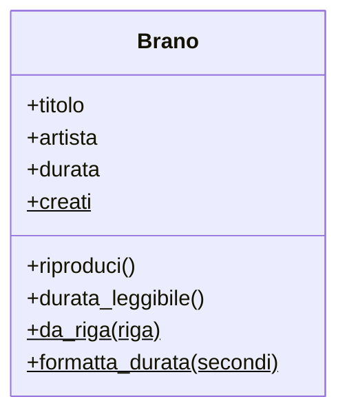

---
layout: epigrafe
autore: Tim Peters, lo Zen di Python
---

Namespaces are one honking great idea — let's do more of those!

---
layout: obiettivi
---

# Da dove partiamo, dove arriviamo

::prerequisiti::

- _Classi, istanze e metodi_: `__init__`, `self`, attributi e metodi
- Funzioni, liste e dizionari
- `"a;b;c".split(";")` per smontare una stringa
- _f-string_

::imparerai::

- **Attributo di istanza** e **attributo di classe**
- Il trabocchetto degli attributi di classe mutabili
- **`@classmethod`**, `cls` e i costruttori alternativi
- **`@staticmethod`**: funzioni che appartengono al tema della classe
- Scegliere fra istanza, classe, statico o funzione

---
layout: enunciato
---

Quanti brani ho creato in totale? La risposta **non appartiene a nessun brano**.

_Bohemian Rhapsody_ non sa nulla di _Blinding Lights_, e non deve saperlo. Esistono dati e comportamenti che appartengono allo **stampo**, la classe, e non al singolo biscotto.

---
layout: sezione
---

# La domanda che nessun brano sa rispondere

Proviamo la strada ingenua: un contatore fuori dalla classe.

---

# Un contatore globale: funziona, ma puzza

<PyRun uscita="destra">

```python
contatore_brani = 0

class Brano:
    def __init__(self, titolo):
        global contatore_brani
        contatore_brani += 1
        self.titolo = titolo

Brano("Bohemian Rhapsody")
Brano("Blinding Lights")
print(contatore_brani)
```

</PyRun>

È un'informazione **su** `Brano` che vive lontano da `Brano`: chiunque può azzerarla. La parola `global` è la spia rossa.

---
layout: sezione
---

# Attributi di classe

Lo stato dello stampo: una sola copia, condivisa da tutte le istanze.

---

# Il contatore vive sullo stampo

<PyRun uscita="destra">

```python
class Brano:
    creati = 0                  # di CLASSE: uno solo

    def __init__(self, titolo):
        Brano.creati += 1
        self.titolo = titolo
        self.riproduzioni = 0   # di ISTANZA: uno per brano

Brano("Bohemian Rhapsody")
Brano("Blinding Lights")
Brano("Bury a Friend")
print(Brano.creati)
```

</PyRun>

---
layout: definizione
titolo: Attributo di istanza e attributo di classe
---

Un **attributo di istanza** si crea con `self.x = …`, di solito in `__init__`: ogni oggetto ne ha la **propria** copia. È lo stato del biscotto.

Un **attributo di classe** si dichiara nel corpo della classe, `x = …`: ne esiste **una sola** copia, condivisa e accessibile come `Classe.x`. È lo stato dello stampo.

---
layout: domanda
affiancata: true
invito: Che cosa stampano le ultime due righe?
---

# Quando la condivisione si ritorce contro

<PyRun seguito>

```python
class Brano:
    tag = []                 # lista di CLASSE

    def __init__(self, titolo):
        self.titolo = titolo

    def aggiungi_tag(self, etichetta):
        self.tag.append(etichetta)
bohemian = Brano("Bohemian Rhapsody")
bury = Brano("Bury a Friend")
bohemian.aggiungi_tag("rock")
bury.aggiungi_tag("electropop")
print(bohemian.tag)
print(bury.tag)
```

</PyRun>

::risposta::

Tutti e due `['rock', 'electropop']`: `tag` è **una sola lista**, appesa allo stampo. Ogni brano scrive sullo stesso oggetto.

---

# La cura: la lista nasce con l'oggetto

<PyRun uscita="destra">

```python
class Brano:
    def __init__(self, titolo):
        self.titolo = titolo
        self.tag = []          # una lista per brano

    def aggiungi_tag(self, etichetta):
        self.tag.append(etichetta)

bohemian = Brano("Bohemian Rhapsody")
bohemian.aggiungi_tag("rock")
print(bohemian.tag)
```

</PyRun>

- Dato **uguale e condiviso** da tutti (contatore, costante) → attributo di classe.
- Dato **proprio** di ogni oggetto, soprattutto liste e dizionari → in `__init__`.

---
layout: domanda
affiancata: true
invito: Perché nel contatore abbiamo scritto Brano.creati e non self.creati? Prevedi le stampe.
---

# Scrivere via self non aggiorna lo stampo

<PyRun seguito>

```python
class Brano:
    creati = 0

    def __init__(self, titolo):
        self.creati += 1      # attenzione
        self.titolo = titolo

a = Brano("A")
b = Brano("B")
print(Brano.creati)
print(a.creati, b.creati)
```

</PyRun>

::risposta::

`0`, poi `1 1`. `self.creati += 1` **legge** il valore di classe ma **assegna** un attributo d'istanza nuovo, che copre quello di classe. Per il dato condiviso si scrive `Brano.creati += 1`.

---
layout: sezione
---

# Metodi di classe

`@classmethod`: un metodo che riceve la classe, `cls`, invece di un oggetto.

---

# Un costruttore alternativo

I brani spesso arrivano da un file: `"Bohemian Rhapsody;Queen;354"`.

<PyRun uscita="destra">

```python
class Brano:
    def __init__(self, titolo, artista, durata):
        self.titolo = titolo
        self.artista = artista
        self.durata = durata

    @classmethod
    def da_riga(cls, riga):
        titolo, artista, durata = riga.split(";")
        return cls(titolo, artista, int(durata))
b = Brano.da_riga("Bohemian Rhapsody;Queen;354")
print(b.titolo, b.durata)
```

</PyRun>

---

# Tre cose da notare

- `da_riga` si chiama **sulla classe**: l'oggetto non esiste ancora, è lei a crearlo.
- `cls` è la classe `Brano`: `return cls(...)` chiama il costruttore normale. Il costruttore alternativo non scavalca `__init__`, **lo usa**.
- Un eventuale contatore `Brano.creati` scatta lo stesso, perché `cls(...)` passa da `__init__`.

<Callout tipo="code" titolo="Perché cls e non Brano?">

Con l'ereditarietà, `Podcast.da_riga(...)` avrà `cls` uguale a `Podcast` e costruirà l'oggetto giusto; `Brano` scritto a mano continuerebbe a sfornare brani. Nei costruttori alternativi si usa **`cls`**.

</Callout>

---

# Più strade, una sola destinazione

```python
@classmethod
def da_dizionario(cls, dati):
    return cls(dati["titolo"], dati["artista"], dati["durata"])
```

```python
Brano("Bury a Friend", "Billie Eilish", 193)
Brano.da_riga("Blinding Lights;The Weeknd;200")
Brano.da_dizionario({"titolo": "Bury a Friend", "artista": "Billie Eilish", "durata": 193})
```

Argomenti sciolti, testo, dizionario: ogni ingresso parla un dialetto diverso e lo traduce nella forma canonica di `__init__`.

---
layout: due-colonne
---

# Un nome per ogni strada

::sinistra::

<Callout tipo="info" titolo="Il seme di un pattern">

Un metodo che consegna un oggetto pronto, nascondendo **come** viene costruito, è il seme del pattern **Factory**. Lo incontreremo per nome più avanti.

</Callout>

::destra::

<Callout tipo="cleancode" titolo="Non un __init__ gonfio">

Niente `__init__(self, titolo=None, riga=None, dati=None)` pieno di `if`. **Un `__init__` per la forma canonica**, e un `@classmethod` con un nome parlante per ogni alternativa.

</Callout>

---
layout: sezione
---

# Metodi statici

`@staticmethod`: niente `self`, niente `cls`. Una funzione che parla del tema della classe.

---

# Trasformare secondi in minuti:secondi

<PyRun uscita="destra">

```python
class Brano:
    def __init__(self, titolo, durata):
        self.titolo = titolo
        self.durata = durata

    @staticmethod
    def formatta_durata(secondi):
        return f"{secondi // 60}:{secondi % 60:02d}"

    def durata_leggibile(self):
        return Brano.formatta_durata(self.durata)

print(Brano.formatta_durata(354))
print(Brano("Bury a Friend", 193).durata_leggibile())
```

</PyRun>

---
layout: enunciato
---

Una classe è anche uno **spazio dei nomi**: un cassetto dove tieni ciò che logicamente sta insieme.

`formatta_durata` vive sotto `Brano` perché parla di durate di brani, ed è lì che chi legge il codice andrà a cercarla. È il senso della citazione di Tim Peters.

---

# Non infilare tutto in una classe

<Callout tipo="warning" titolo="Il confine del metodo statico">

Se una funzione **non ha nulla a che fare** con la classe, un calcolo generico o un'utilità che useresti ovunque, è semplicemente una **funzione del modulo**, fuori dalla classe.

</Callout>

Il test è onesto: questa logica appartiene, **per argomento**, a questa classe? Per `formatta_durata` sì. Per una `radice_quadrata` no. La OOP non è una religione.

---
layout: sezione
---

# I tre tipi, fianco a fianco

La domanda da farsi: di che cosa ha bisogno questo metodo per fare il suo lavoro?

---

# Quale metodo scrivere

| Tipo | Riceve | Lo usi quando | Si chiama |
|---|---|---|---|
| **D'istanza** | `self` | serve lo stato del singolo oggetto | `oggetto.metodo()` |
| **Di classe** | `cls` | serve la classe, o crei istanze | `Classe.metodo()` |
| **Statico** | niente | appartiene al tema della classe | `Classe.metodo()` |

<v-clicks>

1. Ti serve `self.qualcosa`? → metodo **d'istanza**, il caso normale.
2. Ti serve la classe, per costruire istanze? → **`@classmethod`**.
3. Né l'uno né l'altra, ma sta bene vicino alla classe? → **`@staticmethod`**. Altrimenti, funzione del modulo.

</v-clicks>

---
layout: figura
didascalia: I membri dello stampo (creati, da_riga, formatta_durata) sono sottolineati.
---

# Due piani in una scatola sola

::figura::



---
layout: sintesi
---

# In sintesi

<Callout tipo="nutshell" titolo="In a nutshell">

- **Istanza**: `self.x` in `__init__`, una copia per oggetto. **Classe**: `x = …` nel corpo, una copia sola, `Classe.x`.
- Dati condivisi sulla classe; liste e dizionari propri in `__init__`.
- Si modifica la classe scrivendo `Brano.creati += 1`, non `self.creati`.
- **`@classmethod`** riceve `cls`: costruttori alternativi con `return cls(...)`.
- **`@staticmethod`** non riceve niente: funzione di supporto nello spazio dei nomi della classe.
- Domanda guida: l'oggetto, la classe, o niente?

</Callout>

---
layout: quiz
numero: 1 di 3
---

# Dichiari `tag = []` nel corpo della classe, non in `__init__`. Che cosa succede?

<Opzione perche="Succederebbe con `self.tag = []` in `__init__`.">Ogni brano ha la sua lista vuota e indipendente.</Opzione>
<Opzione corretta perche="Esatto: è un attributo di classe, in copia unica sullo stampo.">Tutti i brani condividono la stessa lista.</Opzione>
<Opzione perche="Una lista è un attributo di classe legittimo: il problema è che è una sola.">Python solleva un errore.</Opzione>
<Opzione perche="L'attributo di classe non si azzera da solo: accumula tutto.">La lista torna vuota a ogni nuovo brano.</Opzione>

---
layout: quiz
numero: 2 di 3
---

# Perché scrivere `da_riga` come `@classmethod` con `return cls(...)` e non come funzione con `return Brano(...)`?

<Opzione perche="Le prestazioni non c'entrano.">È più veloce in memoria.</Opzione>
<Opzione perche="`split` funziona ovunque, dentro o fuori una classe.">Una funzione normale non potrebbe usare `split`.</Opzione>
<Opzione corretta perche="Esatto: con l'ereditarietà `cls` sarà la sottoclasse e costruirà il tipo corretto.">Vive sulla classe e, con `cls`, costruisce l'oggetto giusto anche per le classi figlie.</Opzione>
<Opzione perche="Anche un metodo statico può restituire un oggetto: il punto è `cls`.">Un metodo statico non può restituire un oggetto.</Opzione>

---
layout: quiz
numero: 3 di 3
---

# Una funzione converte secondi in `"minuti:secondi"`: non usa né un brano né la classe, ma parla di durate. Come la scrivi?

<Opzione perche="`self` serve solo per leggere lo stato di un brano specifico.">Metodo d'istanza, con `self`.</Opzione>
<Opzione perche="`cls` serve per usare la classe o costruire istanze.">Metodo di classe, con `cls`.</Opzione>
<Opzione corretta perche="Esatto: appartiene al tema di `Brano`, ma non le serve né l'oggetto né la classe.">Metodo statico, con `@staticmethod`.</Opzione>
<Opzione perche="Serve un'operazione che calcoli, non un dato memorizzato.">Variabile di classe con il risultato già calcolato.</Opzione>

---
layout: fine
---

# La prossima lezione

Per mostrare un brano scriviamo ancora a mano `print(f"{b.titolo} — {b.artista}")`. Con **`__str__`** e **`__repr__`** l'oggetto impara a raccontarsi da solo: `print(bohemian)` basterà.
