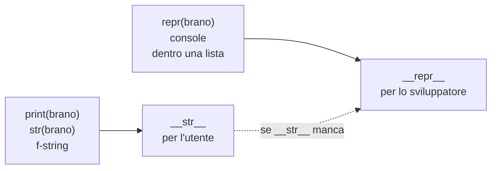

---
layout: epigrafe
autore: William Shakespeare, Romeo e Giulietta
---

What's in a name? That which we call a rose by any other name would smell as sweet.

---
layout: obiettivi
---

# Da dove partiamo, dove arriviamo

::prerequisiti::

- Attributi e metodi d'istanza; `__init__` chiamato da Python
- _f-string_
- La differenza fra **stampare** (`print`) e **restituire** (`return`)
- Che cosa succede quando stampi una lista

::imparerai::

- Che cosa sono i **metodi speciali** (_dunder_)
- **`__str__`**: la descrizione per l'utente
- **`__repr__`**: la descrizione non ambigua per chi programma
- Perché `print(brano)` e `print([brano])` non sono la stessa cosa
- Definisci sempre `__repr__`, `__str__` solo se serve

---
layout: enunciato
---

L'oggetto **sa tutto di sé**, eppure tocca a noi ricostruirgli la frase ogni volta.

`print(f"{bohemian.titolo} — {bohemian.artista}")` è ripetitivo e facile da sbagliare. Oggi il brano impara a presentarsi da solo: basterà `print(bohemian)`.

---
layout: sezione
---

# Che cosa stampa un oggetto «nudo»

Un `Brano` senza metodi speciali, a parte `__init__`.

---
layout: domanda
affiancata: true
invito: Che cosa compare stampando il brano?
---

# Stampiamo un brano

<PyRun>

```python
class Brano:
    def __init__(self, titolo, artista, durata):
        self.titolo = titolo
        self.artista = artista
        self.durata = durata

bohemian = Brano("Bohemian Rhapsody", "Queen", 354)
print(bohemian)
```

</PyRun>

::risposta::

`<__main__.Brano object at 0x…>`: il nome della classe e l'indirizzo in memoria. Python non può indovinare quali dati vuoi vedere né come comporli: **glielo dobbiamo insegnare**.

---
layout: sezione
---

# `__str__`: la faccia per l'utente

`print(qualcosa)` chiama dietro le quinte il metodo `__str__` dell'oggetto.

---

# Il brano dice chi è

<PyRun uscita="destra">

```python
class Brano:
    def __init__(self, titolo, artista):
        self.titolo = titolo
        self.artista = artista

    def __str__(self):
        return f"{self.titolo} — {self.artista}"

bohemian = Brano("Bohemian Rhapsody", "Queen")
print(bohemian)
print(f"In riproduzione: {bohemian}")
```

</PyRun>

`__str__` **restituisce** una stringa; lo usano `print()`, `str()` e le _f-string_. La formattazione vive dentro l'oggetto: è coesione.

---
layout: definizione
titolo: Metodo speciale (dunder)
---

Un **metodo speciale** ha il nome circondato da doppio trattino basso, `__nome__`, e Python lo chiama **automaticamente** in situazioni precise: `__init__` alla nascita dell'oggetto, `__str__` quando lo stampi.

Non lo invochi a mano: scrivi `print(bohemian)` e Python fa il resto. Sono i ganci con cui i tuoi oggetti entrano nel linguaggio.

---
layout: sezione
---

# La sorpresa della lista

Abbiamo definito `__str__`: stampando una playlist vedremo i titoli?

---
layout: domanda
affiancata: true
invito: Prima di eseguire, prevedi l'output.
---

# Una playlist di brani

<PyRun>

```python
class Brano:
    def __init__(self, titolo, artista):
        self.titolo = titolo
        self.artista = artista

    def __str__(self):
        return f"{self.titolo} — {self.artista}"

playlist = [Brano("Bohemian Rhapsody", "Queen"),
            Brano("Blinding Lights", "The Weeknd")]
print(playlist)
```

</PyRun>

::risposta::

Tornano gli indirizzi di memoria. Stampando una **lista**, Python non chiama `__str__` sugli elementi ma l'**altro** metodo speciale, `__repr__`, che non abbiamo ancora scritto.

---
layout: sezione
---

# `__repr__`: la faccia per lo sviluppatore

Due metodi, due domande diverse.

---
layout: due-colonne
sinistra: __str__ · per l'utente
destra: __repr__ · per chi programma
---

# Leggibile o non ambiguo

::sinistra::

Risponde a: **come mostro** questo oggetto a chi usa il programma?

- leggibile, discorsivo
- anche incompleto
- `Bohemian Rhapsody — Queen`

::destra::

Risponde a: **come descrivo** questo oggetto a chi programma?

- preciso, non ambiguo
- idealmente completo
- `Brano('Bohemian Rhapsody', 'Queen', 354)`

---

# Un repr che somiglia al costruttore

<PyRun uscita="destra">

```python
class Brano:
    def __init__(self, titolo, artista, durata):
        self.titolo = titolo
        self.artista = artista
        self.durata = durata

    def __repr__(self):
        return f"Brano({self.titolo!r}, {self.artista!r}, {self.durata})"

    def __str__(self):
        return f"{self.titolo} — {self.artista}"

b = Brano("Bohemian Rhapsody", "Queen", 354)
print(b, repr(b), [b], sep="\n")
```

</PyRun>

---

# Il !r dentro la f-string

<Callout tipo="code" titolo="!r usa il __repr__ del valore">

`{self.titolo!r}` inserisce il valore con il suo `__repr__` invece che con `__str__`. Su una stringa, il `__repr__` aggiunge gli apici: `'Bohemian Rhapsody'`.

</Callout>

- I testi escono **con** gli apici, il numero `354` **senza**.
- Così la rappresentazione somiglia al codice che scriveresti.
- Potresti copiarla, incollarla ed eseguirla per ottenere un brano identico: è questo il senso di **non ambiguo**.

---
layout: figura
didascalia: La freccia tratteggiata è la regola più importante della lezione.
---

# Chi chiama che cosa

::figura::



---
layout: sezione
---

# Quando ne basta uno

Il ripiego va in una sola direzione.

---

# Solo `__repr__`: copre tutto

<PyRun uscita="destra">

```python
class Brano:
    def __init__(self, titolo, artista):
        self.titolo = titolo
        self.artista = artista

    def __repr__(self):
        return f"Brano({self.titolo!r}, {self.artista!r})"

bury = Brano("Bury a Friend", "Billie Eilish")
print(bury)       # niente __str__: usa __repr__
print([bury])
```

</PyRun>

Senza `__str__`, Python ripiega su `__repr__`. Il contrario no: solo `__str__` lascia liste e console con l'indirizzo di memoria.

---

# La regola pratica

<Callout tipo="cleancode" titolo="Sempre __repr__, __str__ solo se serve">

Parti **sempre** da `__repr__`: salva ogni `print`, ogni lista, ogni sessione di debugging. Aggiungi `__str__` **solo** quando la versione per l'utente è davvero diversa.

</Callout>

<Callout tipo="warning" titolo="return, non print, e una stringa">

`print(...)` dentro `__str__` restituisce `None`; `return self.durata` restituisce un numero e dà `TypeError`. La forma giusta è sempre `return f"…"`.

</Callout>

---
layout: sezione
---

# In pratica, sul nostro player

Una playlist, due letture: una per chi ascolta, una per chi mette le mani nel codice. Il nome con cui mostri la rosa cambia; la rosa resta la stessa.

---

# La coda e lo stato interno

<PyRun uscita="destra">

```python
class Brano:
    def __init__(self, titolo, artista):
        self.titolo = titolo
        self.artista = artista
    def __repr__(self):
        return f"Brano({self.titolo!r}, {self.artista!r})"
    def __str__(self):
        return f"{self.titolo} — {self.artista}"

coda = [Brano("Bohemian Rhapsody", "Queen"),
        Brano("Bury a Friend", "Billie Eilish")]
for brano in coda:
    print(f"♪ {brano}")
print(coda)
```

</PyRun>

---

# Il modello dati di Python

<Callout tipo="history" titolo="Una famiglia numerosa">

`__str__` e `__repr__` sono i primi di decine di metodi speciali: `__len__` per `len(oggetto)`, `__eq__` per `==`, `__add__` per `+`, `__iter__` per i cicli `for`. Insieme formano il **modello dati** (_data model_).

</Callout>

Ogni volta che scrivi `__qualcosa__`, stai parlando direttamente all'interprete.

---
layout: sintesi
---

# In sintesi

<Callout tipo="nutshell" titolo="In a nutshell">

- I **metodi speciali** (`__nome__`) li chiama Python in automatico; `__init__` è uno di loro.
- **`__str__`**: leggibile, per l'utente. Lo usano `print()`, `str()`, le _f-string_.
- **`__repr__`**: non ambiguo, per lo sviluppatore. Lo usano `repr()`, la console, liste e dizionari.
- Se manca `__str__`, si usa `__repr__`: definisci **sempre `__repr__`**.
- `{valore!r}` usa il `__repr__` del valore: utile proprio dentro `__repr__`.

</Callout>

---
layout: quiz
numero: 1 di 3
---

# `Brano` ha `__str__` ma non `__repr__`. Che cosa stampa `print([brano])`?

<Opzione perche="Una lista chiede ai suoi elementi il `__repr__`, non lo `__str__`.">La stringa di `__str__`.</Opzione>
<Opzione corretta perche="Esatto: senza `__repr__`, Python usa la rappresentazione di default.">`[<__main__.Brano object at 0x…>]`.</Opzione>
<Opzione perche="`__repr__` non è obbligatorio: senza, c'è la versione di default.">Un errore, perché manca `__repr__`.</Opzione>
<Opzione perche="La lista contiene il brano: conta quale metodo lo rappresenta.">Una lista vuota.</Opzione>

---
layout: quiz
numero: 2 di 3
---

# Puoi scriverne uno solo fra `__str__` e `__repr__`. Quale conviene?

<Opzione perche="Liste, dizionari e console usano `__repr__`: resterebbero illeggibili.">`__str__`, perché lo usa `print`.</Opzione>
<Opzione corretta perche="Esatto: senza `__str__` Python ripiega su `__repr__`, e copri tutto.">`__repr__`, perché Python ci ripiega quando manca `__str__`.</Opzione>
<Opzione perche="Rispondono a domande diverse, e il ripiego non è simmetrico.">È indifferente.</Opzione>
<Opzione perche="Non c'è un ordine obbligato fra i due.">`__str__`, perché `__repr__` richiede prima `__str__`.</Opzione>

---
layout: quiz
numero: 3 di 3
---

# Quale è una buona implementazione di `__repr__` per `Brano(titolo, artista, durata)`?

<Opzione perche="`print` restituisce `None`: serve `return`.">`print(f"{self.titolo}")`</Opzione>
<Opzione perche="Restituisce un numero, non una stringa: `TypeError`.">`return self.durata`</Opzione>
<Opzione corretta perche="Esatto: una stringa che somiglia alla chiamata del costruttore.">`return f"Brano({self.titolo!r}, {self.artista!r}, {self.durata})"`</Opzione>
<Opzione perche="Non dà errori, ma due brani diversi sarebbero indistinguibili.">`return "un brano"`</Opzione>

---
layout: fine
---

# La prossima lezione

Chiunque può ancora scrivere `bohemian.durata = -50`: l'oggetto non si difende. Con l'**incapsulamento** impariamo come un oggetto protegge il proprio stato e decide che cosa lasciar toccare.
