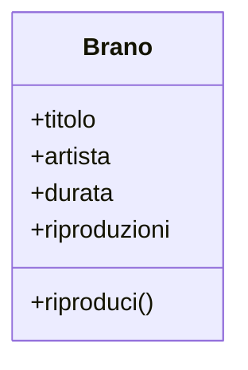

---
layout: epigrafe
autore: Fred Brooks, The Mythical Man-Month (1975)
---

Mostrami i tuoi diagrammi di flusso e nascondimi le tue tabelle, e resterò perplesso. Mostrami le tue tabelle, e di solito i diagrammi non mi serviranno: saranno ovvi.

---
layout: obiettivi
---

# Da dove partiamo, dove arriviamo

::prerequisiti::

- Variabili, tipi primitivi, condizioni, cicli
- Funzioni: parametri e valori di ritorno
- Liste e dizionari, `append`, accesso per indice e per chiave
- _f-string_ per comporre messaggi

::imparerai::

- Perché la posizione è un legame fragile fra i dati
- Errore che ferma il programma e errore silenzioso
- Che cosa risolvono i dizionari e che cosa no
- **Classe**, **oggetto**, **istanza** e **coesione**
- Quando una classe serve davvero

---
layout: enunciato
---

Finora hai imparato a dare istruzioni. Adesso la domanda è: **come rappresento le cose** di cui il programma parla?

Un brano, un giocatore, un conto corrente non sono passi da eseguire: sono entità, con informazioni addosso e operazioni che hanno senso solo su di loro. Lo vediamo su **Risonanza**, un piccolo lettore musicale da terminale.

---
layout: sezione
---

# Rappresentare un brano

Titolo, artista, durata, riproduzioni: con gli strumenti del Volume 1 la strada più diretta è una lista per ogni informazione.

---

# Le liste parallele

A tenere insieme un brano è la **posizione**: l'elemento di indice `i` di ogni lista appartiene allo stesso brano.

<PyRun uscita="destra">

```python
titoli       = ["Blinding Lights", "Bohemian Rhapsody"]
artisti      = ["The Weeknd",      "Queen"]
riproduzioni = [0,                 0]

def riproduci(indice):
    riproduzioni[indice] += 1
    print(f"▶  {titoli[indice]} — {artisti[indice]}")

riproduci(0)
print(riproduzioni)
```

</PyRun>

---
layout: enunciato
---

La corrispondenza esiste **soltanto nella nostra testa**.

Python non sa che `titoli[0]` e `durate[0]` parlano della stessa canzone: per lui sono due liste che al momento hanno la stessa lunghezza. Tenerle allineate è un lavoro nostro, e nessuno ci avvisa quando smettiamo di farlo.

---
layout: sezione
---

# Due modi di rompere l'allineamento

Lunghezze diverse oppure ordini diversi: il primo si fa notare, il secondo no.

---

# Primo modo: una lista resta indietro

```python
titoli.append("As It Was")
artisti.append("Harry Styles")
durate.append(167)
# riproduzioni non è stata aggiornata
```

`riproduzioni` ha tre elementi, le altre quattro. Alla prima chiamata di `riproduci(3)` Python cerca `riproduzioni[3]`, non lo trova e solleva un `IndexError`.

È il **caso fortunato**: il programma si ferma e ti dice dove guardare.

---
layout: domanda
---

# Secondo modo: ordiniamo per durata

<PyRun uscita="destra">

```python
titoli = ["Blinding Lights", "Bohemian Rhapsody", "Bury a Friend"]
durate = [200,               354,                 193]

durate.sort(reverse=True)

for i in range(len(titoli)):
    print(f"{titoli[i]} — {durate[i]}s")
```

</PyRun>

::risposta::

Le durate escono ordinate, 354 → 200 → 193, ma accanto ai titoli sbagliati: _Blinding Lights_ risulta di 354 secondi. `sort` ha riordinato `durate` e nient'altro.

---

# Un errore che il programma non segnala

<Callout tipo="warning" titolo="Nessuna eccezione, dati sbagliati">

Le due liste hanno tre elementi, gli indici da `0` a `2` sono validi, ogni accesso restituisce un valore che esiste. L'unica cosa sbagliata è l'**abbinamento**, e l'abbinamento non è scritto da nessuna parte nel codice.

</Callout>

Un programma che si ferma con un errore è scomodo ma leale. Uno che prosegue con numeri plausibili ti lascia scoprire il guasto mesi dopo.

Il colpevole non è `sort`: le informazioni di un brano sono sparse su quattro strutture, legate solo da un numero.

---
layout: sezione
---

# I dizionari raccolgono i dati

Uno strumento del Volume 1 sistema buona parte della faccenda.

---
layout: due-colonne
rapporto: 1/1
---

# Tutti i dati di un brano in una struttura sola

::sinistra::

<PyRun>

```python
brano = {
    "titolo": "Bohemian Rhapsody",
    "artista": "Queen",
    "durata": 354,
    "riproduzioni": 0,
}

brano["riproduzioni"] += 1
print(brano["riproduzioni"])
```

</PyRun>

::destra::

Una lista di dizionari si ordina, si filtra, si rimescola: ogni dizionario si porta dietro tutti i suoi campi. **Il disallineamento non può nascere.**

È un passo avanti vero, e per molti programmi è già la soluzione definitiva.

---
layout: due-colonne
sinistra: Le operazioni stanno altrove
destra: Non c'è posto per le regole
---

# Che cosa il dizionario non fa

::sinistra::

Riprodurre un brano o convertirne la durata sono **funzioni sparse nel file**.

Niente dichiara che riguardano proprio quel tipo di dizionario: per sapere che cosa si può fare con un brano devi leggere tutto il modulo.

::destra::

`brano["durata"] = -5` viene accettato.

`brano["titlo"] = "…"` crea una chiave nuova: il refuso resta lì e te ne accorgi solo rileggendo `brano["titolo"]`.

Il concetto di «brano valido» non esiste dentro un dizionario.

---
layout: sezione
---

# Tenere insieme dati e comportamento

Le informazioni di un'entità e le operazioni che la riguardano si dichiarano nello stesso posto.

---
layout: definizione
titolo: Oggetto, classe, istanza
---

Un **oggetto** riunisce in un'unica unità i **dati** che descrivono un'entità (il suo **stato**) e i **comportamenti** che operano su quei dati.

Una **classe** descrive un tipo di oggetto: quali dati avrà e quali operazioni saprà compiere. Un oggetto costruito da una classe è un'**istanza** di quella classe.

---

# La classe `Brano`

Conta **dove** stanno i dati e ciò che sai farci; `self` e `__init__` sono la prossima lezione.

<PyRun uscita="destra">

```python
class Brano:
    def __init__(self, titolo, artista):
        self.titolo = titolo
        self.artista = artista
        self.riproduzioni = 0

    def riproduci(self):
        self.riproduzioni += 1
        return f"▶  {self.titolo} — {self.artista}"

bohemian = Brano("Bohemian Rhapsody", "Queen")
print(bohemian.riproduci())
```

</PyRun>

---

# Una classe è uno stampo

- Esiste **una volta sola** nel codice, e da lì escono quanti oggetti vuoi.
- Ogni oggetto ha **i propri valori**: un secondo brano ha il suo contatore, indipendente dal primo.
- Lo stampo non contiene i biscotti: descrive la forma, che si applica quando crei l'oggetto.

<Callout tipo="cleancode" titolo="Coesione">

Quanto le parti di un'unità di codice riguardano la stessa cosa. Le liste parallele ne hanno pochissima, la classe `Brano` risponde in un punto solo a «com'è fatto un brano». Ma **coesione non vuol dire ammassare**: salvare i brani su disco o cercarli per artista stanno meglio altrove.

</Callout>

---

# Il bug dell'ordinamento non si può più scrivere

Qualunque cosa tu faccia all'ordine, sposti **oggetti interi**: ogni titolo si porta dietro la sua durata.

<PyRun uscita="destra">

```python
class Brano:
    def __init__(self, titolo, durata):
        self.titolo = titolo
        self.durata = durata

brani = [Brano("Blinding Lights", 200),
         Brano("Bohemian Rhapsody", 354),
         Brano("Bury a Friend", 193)]
brani.reverse()
for brano in brani:
    print(f"{brano.titolo} — {brano.durata}s")
```

</PyRun>

---
layout: enunciato
---

Sparisce quel bug, **non la possibilità di sbagliare**.

`bohemian.durata = -5` passa ancora senza proteste: la classe non controlla niente. Hai ottenuto qualcosa di più modesto e più utile: un posto preciso in cui le regole potranno stare. È il tema dell'incapsulamento.

---
layout: figura
didascalia: Lo scomparto superiore elenca gli attributi, quello inferiore i metodi.
---

# La classe disegnata in UML

::figura::



---
layout: sezione
---

# Procedurale e oggetti, un confronto onesto

Il confronto con le liste parallele è troppo facile: un programma procedurale scritto bene userebbe un dizionario.

---
layout: due-colonne
sinistra: A oggetti
destra: Procedurale
---

# Due versioni che fanno la stessa cosa

::sinistra::

```python
class Brano:
    def __init__(self, titolo, artista):
        self.titolo = titolo
        self.artista = artista
        self.riproduzioni = 0

    def riproduci(self):
        self.riproduzioni += 1

brano = Brano("Bury a Friend",
              "Billie Eilish")
brano.riproduci()
```

::destra::

```python
def crea_brano(titolo, artista):
    return {
        "titolo": titolo,
        "artista": artista,
        "riproduzioni": 0,
    }

def riproduci(brano):
    brano["riproduzioni"] += 1

brano = crea_brano("Bury a Friend",
                   "Billie Eilish")
riproduci(brano)
```

---
layout: due-colonne
sinistra: Dove si cerca
destra: Dove si controlla
---

# Le differenze vere non riguardano la velocità

::sinistra::

A oggetti, l'elenco di ciò che un brano sa fare **coincide con la classe**: apri `Brano` e lo leggi tutto.

In procedurale devi scorrere il modulo e indovinare quali funzioni si aspettano un brano.

::destra::

`riproduci(brano)` si fida di ricevere un dizionario fatto bene: ogni funzione deve controllare per conto proprio.

Una classe ti dà **un solo punto d'ingresso** in cui stabilire che cosa conta come brano valido.

---

# Quando conviene

<v-clicks>

- Il programma gestisce **parecchie entità** con stato e comportamento propri.
- Le stesse entità compaiono in **punti lontani** del codice.
- Il programma è destinato a **durare** e a essere modificato da altri.
- Uno script di trenta righe che legge un file e stampa una media **non ci guadagna niente**: solo righe.

</v-clicks>

Python non ti chiede di schierarti: funzioni, dizionari e classi convivono nello stesso file.

---

# Da dove arriva

<Callout tipo="history" titolo="Simula, Smalltalk e Alan Kay">

Fine anni Sessanta: **Simula**, linguaggio norvegese per le simulazioni. Per simulare un porto conveniva rappresentare le cose di quel mondo, ognuna con il suo stato.

Anni Settanta: **Alan Kay**, allo Xerox PARC, crea **Smalltalk**, dove un programma è un insieme di piccole entità che si scambiano messaggi. Kay ripeterà per decenni che la OOP dei linguaggi di oggi non è quella che intendeva lui: quella di Python è una versione più addomesticata.

</Callout>

---
layout: sintesi
---

# In sintesi

<Callout tipo="nutshell" titolo="In a nutshell">

- La difficoltà di un programma che cresce sta nel modo in cui **rappresenta le sue entità**.
- Le **liste parallele** si rompono in due modi: `IndexError` esplicito, oppure dati sbagliati in silenzio.
- Un **dizionario** tiene insieme i dati, ma lascia fuori le operazioni e le regole.
- Una **classe** dichiara insieme dati e comportamenti; un **oggetto** è un esemplare con i propri valori.
- **Coesione**: vicino ciò che cambia insieme, senza ammassare.
- Le classi si usano quando ripagano la complessità che aggiungono.

</Callout>

---
layout: quiz
numero: 1 di 3
---

# Hai due liste parallele `titoli` e `durate` di tre elementi, e ordini soltanto `durate`. Che cosa succede?

<Opzione perche="Ordinare tre elementi è istantaneo: il problema è quali dati finiscono accanto a quali.">Il programma rallenta sensibilmente.</Opzione>
<Opzione perche="`sort` cambia l'ordine, non il numero degli elementi: gli indici restano validi.">Python solleva un `IndexError`.</Opzione>
<Opzione corretta perche="Esatto: ogni accesso è legittimo, l'unica cosa sbagliata è l'abbinamento.">Nessun errore, ma ogni titolo può finire accanto alla durata di un altro brano.</Opzione>
<Opzione perche="`sort` riordina sul posto, non rimuove niente.">Le durate vengono eliminate dalla lista.</Opzione>

---
layout: quiz
numero: 2 di 3
---

# Qual è l'idea da cui nasce la programmazione a oggetti?

<Opzione perche="Le classi convivono con le funzioni: spesso una funzione resta la scelta migliore.">Sostituire tutte le funzioni con le classi.</Opzione>
<Opzione corretta perche="Esatto: incapsulamento, ereditarietà e polimorfismo sfruttano questa scelta.">Dichiarare nello stesso posto i dati di un'entità e le operazioni che la riguardano.</Opzione>
<Opzione perche="I dizionari restano ottimi: non tengono insieme dati e operazioni, ma risolvono il disallineamento.">Evitare i dizionari, che non proteggono i dati.</Opzione>
<Opzione perche="La OOP riguarda l'organizzazione del codice, non la velocità.">Rendere il programma più veloce.</Opzione>

---
layout: quiz
numero: 3 di 3
---

# Con la classe `Brano` di questa lezione, quale problema **non** hai risolto?

<Opzione perche="Titolo e durata sono attributi dello stesso oggetto: si spostano insieme.">Ordinare i brani può scollegare titolo e durata.</Opzione>
<Opzione corretta perche="Esatto: `bohemian.durata = -5` passa. Hai un posto dove mettere il controllo, non il controllo.">Niente impedisce una durata negativa.</Opzione>
<Opzione perche="Con la classe la descrizione di un brano sta in un punto solo.">Aggiungere un campo richiede di modificare più punti.</Opzione>
<Opzione perche="Ogni oggetto ha il proprio stato e il proprio contatore.">I brani condividono il contatore delle riproduzioni.</Opzione>

---
layout: fine
---

# La prossima lezione

Che cosa succede quando scrivi `Brano(...)`, che ruolo ha `__init__`, perché `self` è il primo parametro di ogni metodo. Ripartiamo da `Brano` e gli affianchiamo la **`Playlist`** di Risonanza.
